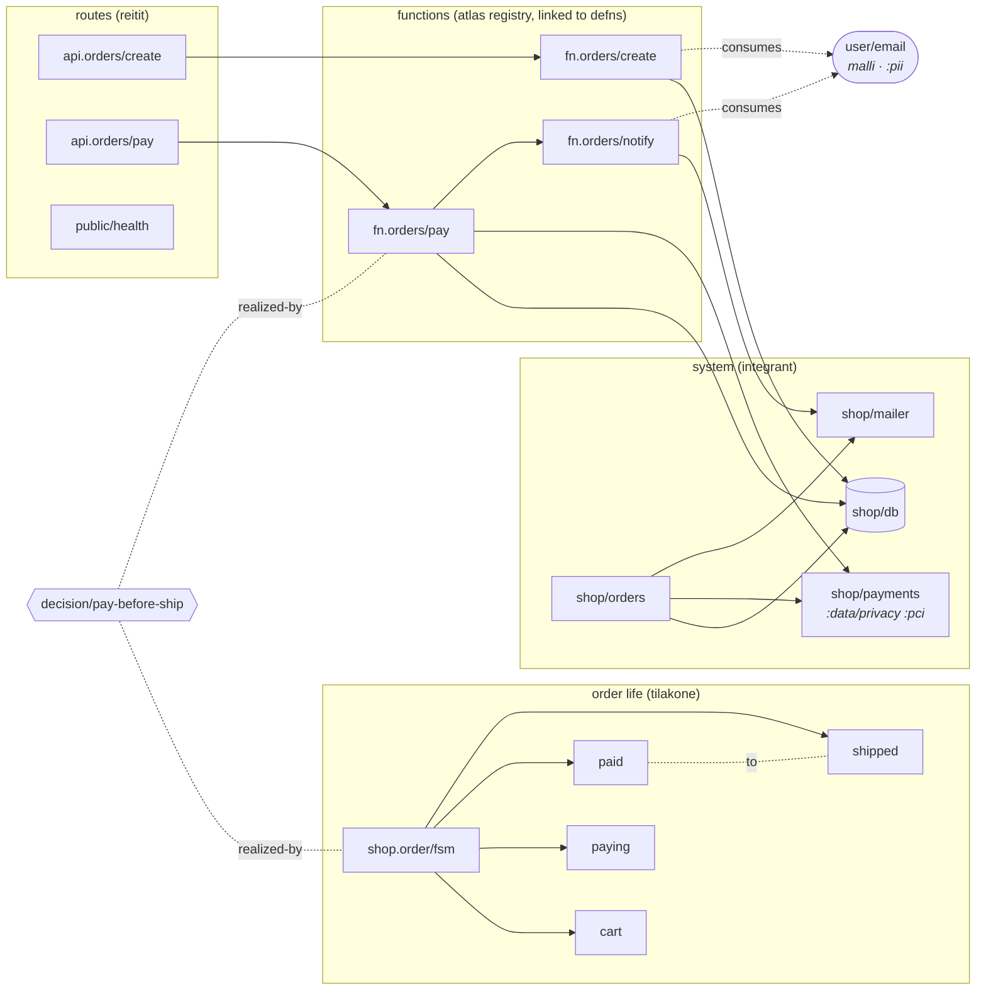

# meta-source demo: a shop

A small Clojure shop that runs, and what
[meta-source](https://github.com/semantic-namespace/meta-source) reads of it
**without running it**.

It uses five libraries, each with its own registry:

| library | what it declares here | where |
|---|---|---|
| [integrant](https://github.com/weavejester/integrant) | the system: db, payments, mailer, orders, router, server | `resources/system.edn`, `src/shop/system.clj` |
| [reitit](https://github.com/metosin/reitit) | the routes | `src/shop/http.clj` |
| [malli](https://github.com/metosin/malli) | the shapes of the data keys | `src/shop/schema.clj` |
| [tilakone](https://github.com/metosin/tilakone) | an order's life: cart → paying → paid → shipped, or cancelled | `src/shop/order.clj` |
| [atlas](https://github.com/semantic-namespace/atlas) | what the code can't say: what each thing is, what it needs, the data it reads and returns, a decision | `registry/shop.edn` |

Then there are the team's rules, over all of it, in `rules/shop.edn`.

## How it connects

Each id is one entity, whichever library declares it. The route
`:api.orders/pay` is reitit's (path, method, handler) and atlas's (type,
aspects, the function it calls) at once.



## Run it

```sh
clojure -M:run
curl -s localhost:3000/public/health
curl -s -XPOST localhost:3000/api/orders -H 'content-type: application/json' \
     -d '{"user/email":"ana@example.com","order/lines":[{"line/sku":"tea","line/qty":2}]}'
curl -s -XPOST localhost:3000/api/orders/<id>/pay
curl -s localhost:3000/api/orders/<id>        # "order/state": "shop.order/paid"
```

## Read it

Needs [babashka](https://babashka.org). meta-source, its packs and atlas are
pinned to exact commits (`bb.edn`, `meta-source.edn`).

```sh
bb meta-source check --brief          # clean on main
bb meta-source uses :shop/payments    # what refers to it, and how
bb meta-source hover :api.orders/pay  # one entity, from reitit and the registry
bb report                             # each rule and what it applies to; reach, untyped vs typed
```

`bb report` shows what typing the keys does. With every key a plain
dependency, each state of the order machine "depends on" the whole machine
through its back-pointer. With the packs saying what their keys mean (a
machine depends on its states; a state's machine and its transitions are
relations), reach goes from 76 pairs to 40 and no entity loses a real
dependency.

## Break it

Each `scenario/*` branch is one change away from `main`, and gives one
finding. Nothing is run to find them.

| branch | the change | what meta-source says | what running would do |
|---|---|---|---|
| `scenario/1-missing-component` | orders refers to `:shop/metrics` | `no config defines :shop/metrics` | `ig/init` throws at startup |
| `scenario/2-ship-before-pay` | a `::rush` transition from paying to shipped | `An order reaches shipped only from paid … (:shop.order/paying)` | runs; ships unpaid orders |
| `scenario/3-state-typo` | `::tk/to ::shiped` | error: `goes to :shop.order/shiped, which is no state of it`, and `shipped` is now unreachable | runs until an order ships, then it's in a state no machine knows |
| `scenario/4-unaudited-pii` | a new function reads `:user/email` | `Whatever reads a PII key is audited: :user/email (:fn.orders/receipt-email)` | runs |
| `scenario/5-public-reaches-db` | a `/public/status` page counts orders | two rules, with the path: `:public/status (:shop/orders → :shop/db)`, and it now reaches payments | runs |

```sh
git checkout scenario/2-ship-before-pay && bb meta-source check --brief
```

## In the editor

With [meta-source.el](https://github.com/semantic-namespace/meta-source#install),
Eldoc describes the keyword at point, `M-.` goes to each place that declares
it, `M-?` lists what uses it, `C-c .` opens the describe buffer, and Flymake
underlines what `check` finds.

---

*Experimental, like meta-source itself.*
